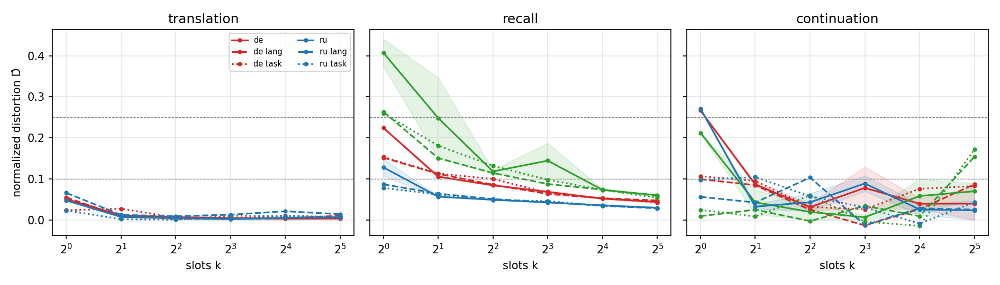
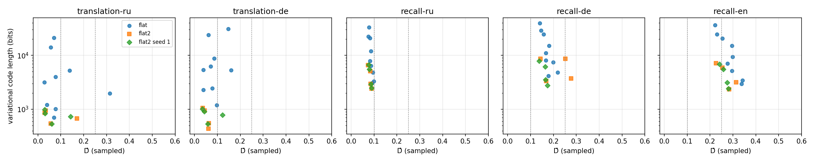
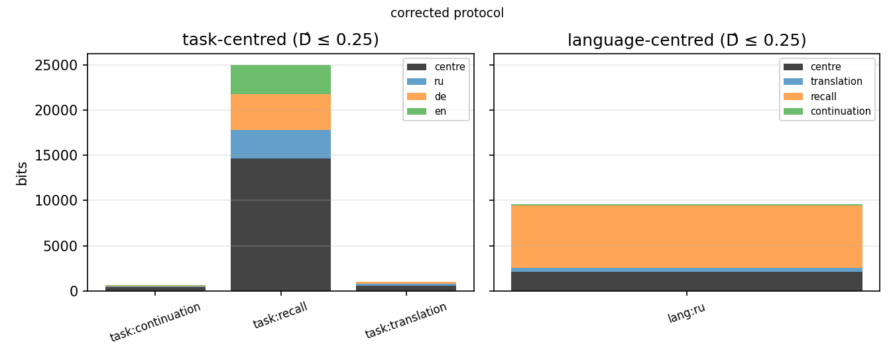
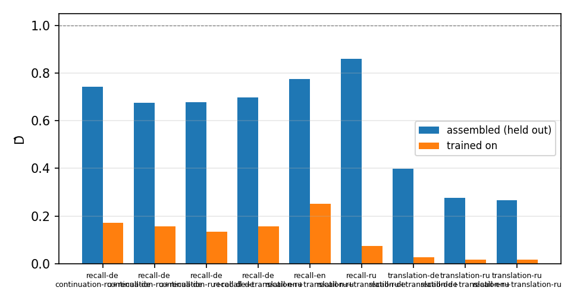
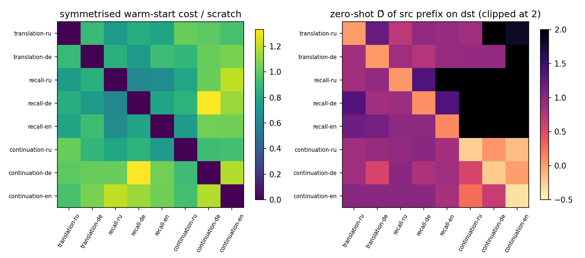
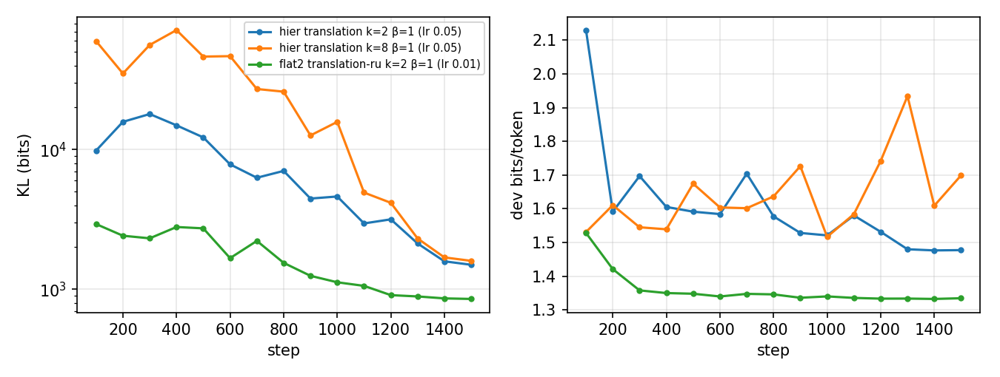

# Abstract {-}

A frozen language model is a fixed machine; a soft prefix that makes it perform a task is a program for that machine, and the shortest such program is a model-relative description length of the task. We measure this length for a frozen Qwen2.5-1.5B over three tasks (translation from English, factual recall, sentence continuation) and three output languages (Russian, German, English), in two units: the number of prefix positions, and the description length of the prefix in bits under a variational code with a prior fitted to the model's token-embedding matrix. Four results. (i) The number of positions is not a description length: translation saturates at one position, one trained position outperforms a natural-language instruction on every cell, and giving the model the language or the task saves the same number of positions. (ii) In bits, a translation program costs about 500 bits at 10% excess loss, a Russian recall program 2,400, and English recall is the most expensive program on the grid. (iii) Coding a group of cells as a shared centre plus per-member deviations saves no bits in either nesting: adding a language to a task program and adding a task to a language program cost the same within the seed variation, the task-centred hierarchy costs 1.9 times the independent programs on the measurable cells, and the language-centred one only breaks even. The asymmetry between tasks is in the mechanism: most of a translation program's effect is recovered by patching the first block alone, a recall program's only by several blocks deep in the network. (iv) The variational objective selects compact programs but the standard optimiser does not find them; a smaller step size and checkpoint selection on the full objective lower every measured frontier by 20--71%.

# Introduction

Prompt tuning (Lester et al. 2021) and prefix tuning (Li and Liang 2021) adapt a frozen language model by optimising a few continuous vectors prepended to the input. Read as engineering, these are parameter-efficient fine-tuning methods. Read as computation, the frozen model is an interpreter and the prefix is a program for it, and the shortest prefix that makes the model perform a task is a description length of that task relative to the model: the number of bits a sender must transmit to a receiver who holds the model, so that the receiver can perform the task (Hinton and van Camp 1993; Blier and Ollivier 2018; Shaw et al. 2026).

For a multilingual model this quantity can be compared across tasks and output languages. We ask four questions. How long is the program for a task, and how does its length depend on the output language? Does the program decompose into a task part and a language part, and if so which part is the expensive one, can the parts be shared between cells, and can they be composed? How far apart are the programs of different cells? Where in depth does the model read a program? All lengths are relative to one model, tokenizer and input format; the claims are orderings, differences and ratios within that model.

# Measurement framework

**Interpreter, program, distortion.** The prefix $P \in \mathbb R^{k \times d}$ occupies the first $k$ positions of the input sequence, where $d = 1536$ is the model's embedding dimension. The model's weights, tokenizer and format are fixed. Distortion is measured by the teacher-forced code length $L$ of the target in bits per target token. Let $m$ be the number of examples in the dataset being evaluated, $(x_n, y_n)$ the input and target of example $n$, and $N$ the total number of target tokens. For a prefix $P$, define the average negative log-likelihood as
$$
L(P) = -\frac{1}{N} \sum_{n=1}^{m} \log_2 p_M(y_n \mid x_n, P),
$$
where the probability of a target is the product over its tokens, each conditioned on the ground-truth preceding target tokens. In the training objective below, $L$ and $N$ refer to the training set; reported distortion uses held-out losses.

To compare across task--language pairs, we normalise the loss per pair:
$$
\hat D = \frac{L - L_{\text{floor}}}{L_{\text{none}} - L_{\text{floor}}},
$$
where $L_{\text{none}}$ is the no-prefix loss and $L_{\text{floor}} = \min\{L_{\text{LoRA}}, L_{\text{best prefix}}\}$ is the lower of two empirical reference losses: a per-pair rank-16 LoRA fine-tune of the attention projection matrices, with the pretrained weights frozen, and the best unpenalised prefix over the $k$ sweep. All three losses are evaluated on the same dataset. On the two translation and three continuation pairs the best prefix sets the floor; on the three recall pairs LoRA does, by 0.19--0.24 bits per token. The distortion thresholds $\hat D \le 0.25$ and $\hat D \le 0.10$ were chosen in advance from a development pilot, and $\hat D \le 0.05$ is reported as exploratory. On translation-ru, for instance, $L_{\text{none}} = 1.92$, $L_{\text{floor}} = 1.34$, and a prefix with $L = 1.38$ has $\hat D = 0.06$.

**Two units and the rate--distortion objective.** *Slots* are the number $k$ of prefix positions, and the slot complexity $k^\ast$ is the smallest $k$ that reaches a distortion threshold, found by sweeping $k$ with free, unpenalised vectors. *Bits* are the description length of the prefix under a prior: each slot $i$ has a diagonal Gaussian posterior $q_i = \mathcal N(\mu_i, \mathrm{diag}\,\sigma_i^2)$, and the full prefix distribution is $q = \bigotimes_{i=1}^{k} q_i$, trained with the reparameterisation trick as in a variational autoencoder (Figure \ref{fig:sampling}). We measure the expected description length of the sampled prefix, in bits, as
$$
R(q) = D_{\mathrm{KL}}(q \,\|\, \pi_0) / \ln 2 ,
$$
where $\pi_0$ is the product over slots of one diagonal Gaussian prior per slot, with per-coordinate mean and variance fitted to the model's token-embedding matrix, under an idealised bits-back coding scheme. The rate--distortion frontier of a task--language pair is the smallest $R$ among runs that reach a distortion threshold, over $k$ and the KL weight $\beta$. Distortion of a variational prefix is scored on posterior samples, because the sample is the coded object; Section \ref{sec:opt} shows what goes wrong when the posterior mean is scored instead.

The variational objective is
$$
\mathcal J_\beta(q) = \mathbb E_{P \sim q}[L(P)] + \frac{\beta}{N}\,\frac{D_{\mathrm{KL}}(q \,\|\, \pi_0)}{\ln 2} .
$$
Both terms are measured in bits per training target token. The first is the expected data code length per token, the second the prefix description length averaged over the training tokens. Multiplying by $N$ gives
$$
N \mathcal J_\beta(q) = N\,\mathbb E_{P \sim q}[L(P)] + \beta R(q),
$$
which for $\beta = 1$ is the idealised total expected description length of the data under the bits-back scheme, ignoring coding overheads. The expectation over $P \sim q$ is estimated with one sample per training step; reported distortion averages eight passes over the test set with a fresh sample per batch of 32 examples.

{#fig:sampling}

**Hierarchy.** To put task bits and language bits in one currency, a group $G$ of pairs (the languages of one task, or the tasks of one language) is coded jointly. A shared centre $c \sim q_c$ has rate $D_{\mathrm{KL}}(q_c \,\|\, \pi_0)$; each member $g \in G$ has a deviation $\delta_g \sim q_g$ with rate $D_{\mathrm{KL}}(q_g \,\|\, \pi_\delta)$, where $\pi_\delta = \mathcal N(0, \tau^2 \sigma_0^2 I)$ is a zero-centred Gaussian with the per-coordinate scale $\sigma_0$ of $\pi_0$ and $\tau = 1$, so that a displacement costs the same bits in a deviation as in a whole prefix. The member's prefix is $P_g = c + \delta_g$. The group's description length is
$$
R_G = \frac{1}{\ln 2}\Big( D_{\mathrm{KL}}(q_c \,\|\, \pi_0) + \sum_{g \in G} D_{\mathrm{KL}}(q_g \,\|\, \pi_\delta) \Big).
$$
Training alternates over members; the step for member $g$ minimises its mean target NLL plus $\beta$ times the centre rate divided by the group's total training tokens and the deviation rate divided by the member's own, so the centre is amortised over the group and each deviation over its member. Grouping by task makes the centre the task part and the deviations the language parts; grouping by language reverses the roles. A group reaches a threshold only when every member does in the same run. Sharing compresses if $R_G$ is smaller than the sum of the members' independent frontiers.

**Derived measurements.** *Composition*: one tied task part per task and one tied language part per language, concatenated into a prefix of $k_{\text{task}} + k_{\text{lang}}$ slots, trained on all pairs or with pairs held out and assembled zero-shot. *Distance*: $K_M(a \mid b)$, the prequential cost of training from pair $b$'s prefix toward pair $a$ over a fixed budget of 512 examples in doubling blocks, symmetrised and divided by the from-scratch costs (Bennett et al. 1998; Li et al. 2004); and the zero-shot distortion of $b$'s prefix applied unchanged to $a$. *Mechanism*: the hidden states at the prefix positions of a trained prefix are patched into the attention input of one block of a run with a random prefix of the same $k$, for every block; the recovered loss relative to the full effect is the fraction of the program read at that block. *Regime 2*: $m'$ per-example vectors replacing the input tokens, with and without the task prefix, as a slot count.

# Experimental setup

**Model, data, grid.** Qwen2.5-1.5B base, frozen, bfloat16 on an A100. Translation and continuation use FLORES+ (dev split for training and selection, devtest for reporting); recall uses mLAMA (Kassner et al. 2021) with an English cloze prefix and the object rendered in the target language, split by item. Translation into English is excluded, so the grid has eight pairs, called cells: translation-{ru, de}, recall-{ru, de, en}, continuation-{ru, de, en}. Test sets hold 1,012 sentences per translation cell and 4,451--6,496 facts per recall cell.

**Runs.** Design A (slot sweep): $k \in \{1, 2, 4, 8, 16, 32\}$, two seeds, 1500 steps, batch 16, AdamW with cosine decay; repeated with the target language given, the task given, and the natural-language prompt with no prefix; per-cell LoRA floors. Flat variational (corrected protocol): $k \in \{2, 4\}$, $\beta \in \{1, 3\}$, two seeds, on the five measurable cells. Hierarchical: both nestings on the same grid, one seed. Composition: $1{+}1$, $2{+}2$, $4{+}4$ slots with five hold-out sets. Distance: every cell's $k = 4$ prefix toward every cell. Regime 2: $m' \in \{1, 2, 4, 8\}$ on 100 examples in four cells. Mechanism: eight cells, five probes, 28 blocks. Language groups retrained on their two measurable members (translation, recall) on the same grid. Zero-rate baselines: eight draws from $\pi_0$ and eight random token rows per cell at $k \in \{2, 4\}$, scored without training. In total 1,937 result rows and about 37 A100 hours; every number and figure is regenerated from the result tables by one notebook.

**Two variational protocols.** The preregistered protocol used learning rate 0.05, the checkpoint with the lowest development distortion at the posterior mean, and $\sigma$ initialised at five times the prior. Its training histories (Section \ref{sec:opt}) showed that this overshoots the rate and selects on the wrong statistic. The corrected protocol uses learning rate 0.01, scores development distortion on samples, selects the checkpoint with the lowest objective $\mathcal J_\beta$, and initialises $\sigma$ at the prior. It is the headline wherever it exists. The hierarchical design was run under both; the corrected runs are the headline for every hierarchical comparison, and the preregistered ones appear only in Section \ref{sec:opt}.

**Continuation is unmeasurable.** Its floor lies within 0.10--0.16 bits per token of its no-prefix loss, below the seed variation, so the denominator of $\hat D$ is noise. Continuation is kept in the tables and excluded from every claim. The five measurable cells are translation-ru, translation-de, recall-ru, recall-de and recall-en.

# Results

## Slots are not a description length

{#fig:curves}

Figure \ref{fig:curves} shows $\hat D$ against $k$. Translation reaches $\hat D \le 0.10$ with one slot in every language and conditioning and is flat from there. Recall keeps improving to $k = 32$ on Russian and German with the budget binding: a 3000-step run on recall-ru at $k = 8$ moves $\hat D$ from 0.043 to 0.032 and is still falling. Seed gaps are below 0.011 on translation, 0.042 on recall-ru and recall-de, and 0.20 on recall-en, the one cell where the slot curve is not reliable. Table \ref{tab:kstar} gives $k^\ast$.

| cell | $k^\ast(0.25)$ | $k^\ast(0.10)$ | $k^\ast(0.05)$, exploratory |
|---|---|---|---|
| translation-ru | 1 | 1 | 1 |
| translation-de | 1 | 1 | 2 |
| recall-ru | 1 | 2 | 4 |
| recall-de | 1 | 4 | 32 |
| recall-en | 2 | 16 | not reached |

Table: Slot complexity $k^\ast$: the smallest $k$ at which Design A reaches each threshold. \label{tab:kstar}

Two observations make the slot count unusable as a description length. First, the natural-language prompt, scored as a context with no prefix, is far worse than one trained slot: on recall it leaves $\hat D$ at 0.91--0.96 and one slot reaches 0.13--0.41; on translation it leaves 0.12--0.20 and one slot reaches 0.05. A single trained vector does more than an instruction of many tokens, so a slot count is not commensurable with a token count. Second, conditioning saves little on the slot axis: giving the language or the task changes $k^\ast(0.10)$ in none of the translation cells and in two recall cells (recall-ru 2 to 1, recall-en 16 to 8), identically for either conditioning. Averaged over the measurable cells, $\Delta k_{\text{lang}}$ and $\Delta k_{\text{task}}$ are both 1.8 slots, and 8 of those 9 slots come from recall-en. The slot axis cannot distinguish telling the model the language from telling it the task; the bit axis can (Section \ref{sec:hier}).

## Description length in bits

{#fig:frontier}

Table \ref{tab:bits} gives the frontier: the smallest $R$ among runs reaching each threshold under the corrected protocol, first seed.

| cell | bits at $\hat D \le 0.10$ | bits at $\hat D \le 0.25$ | best $\hat D$ |
|---|---|---|---|
| translation-de | 436 | 436 | 0.036 |
| translation-ru | 542 | 542 | 0.030 |
| recall-ru | 2,419 | 2,419 | 0.075 |
| recall-de | not reached | 3,343 | 0.143 |
| recall-en | not reached | 7,155 | 0.226 |

Table: Rate--distortion frontier in bits, corrected protocol. Where the cheapest run under 0.25 is already under 0.10 the two columns coincide. A second seed reproduces the values within 4% on translation-ru, recall-ru and recall-en and within 22% on translation-de and recall-de, in opposite directions, with the same ordering of cells (Table \ref{tab:seeds}). \label{tab:bits}

A translation program costs about 500 bits. A Russian recall program costs five times that; German and English recall do not reach 10% excess loss within the budget and cost 3,300 and 7,200 bits at 25%. Selecting the qualifying runs on development rather than test distortion reproduces every value in the table except recall-en at 0.25, where the cheapest development-qualifying run (5,933 bits) has test distortion 0.253 and misses the test threshold; the 7,155-bit program is the one that qualifies on both sets. The bits are measured from the no-prefix loss, and the zero-rate program is no better than it: $k$ vectors drawn from $\pi_0$ leave $\hat D$ at 0.91--0.96 on translation and 0.93--0.98 on Russian and German recall, and make English recall worse than no prefix (1.07--1.12), averaged over eight draws (Table \ref{tab:baseline}). The ordering across tasks follows the learning gap $L_{\text{none}} - L_{\text{floor}}$ (recall 3.5--6.2 bits per token, translation 0.6--0.9), as hypothesis H1 expected. The ordering across languages does not follow exposure: English recall is the dearest program, not the cheapest, in slots ($k^\ast(0.10) = 16$) and in bits, and the result survives restricting all three recall test sets to the 4,212 items they share ($\hat D$ at $k = 4$: ru 0.049, de 0.079, en 0.122). The English LoRA floor is also the worst of the three (2.58 bits per token against 1.10 for Russian). This is consistent with the difficulty lying in the English rendering of the mLAMA items rather than in English as an output language, but tokenisation and the output distribution could contribute, and the experiments do not separate them. The language part of H1 is not supported.

## Neither nesting is cheaper, and sharing does not compress {#sec:hier}

{#fig:hier}

Table \ref{tab:groups} compares each group's $R_G$ with the sum of its members' independent frontiers from Table \ref{tab:bits}, at $\hat D \le 0.25$, the only level every measurable cell reaches; continuation is excluded on both sides.

| group ($\hat D \le 0.25$) | hierarchy, bits $(k, \beta)$ | independent, bits | ratio |
|------------------------|------------|-----------|------|
| translation: ru, de | 1,029 (4, 3) | 978 | 1.05 |
| recall: ru, de, en | 24,972 (4, 1) | 12,917 | 1.93 |
| all five measurable cells | 26,001 | 13,895 | 1.87 |
| Russian: translation, recall | 3,363 (2, 3) | 2,961 | 1.14 |
| German: translation, recall | 3,682 (2, 3) | 3,779 | 0.97 |
| English: recall | not reached | 7,155 | -- |

Table: Task-centred (top three rows) and language-centred (bottom three) hierarchies against the sum of the members' independent frontiers on the measurable cells, corrected protocol. The language groups were retrained on their two measurable members. The three-member language groups that include unmeasurable continuation cost 4,353 (ru) and 4,560 (de) bits as trained and, restricted post hoc to their measurable members, 1.45 and 1.19 times the independent programs; those values are indicative only, since their centres were trained with continuation in the group. \label{tab:groups}

**Sharing does not compress.** Over the five measurable cells the task-centred hierarchy costs 1.87 times the independent programs: parity on translation and 1.9 times on recall. The language-centred hierarchies, retrained on their measurable members, are at parity (1.14 and 0.97) and do not bring English recall under 0.25. The recall factor decomposes into two parts. At matched $(k, \beta)$ a hierarchy costs 0.94--1.5 times the sum of the corrected flat runs with the same hyper-parameters, with worst-member distortion within 0.03 of the independent runs at six of the eight grid points and worse by 0.05--0.28 at the other two, so the shared centre buys nothing. The frontier comparison then adds the cost of one $\beta$ serving every member: on recall the only task-centred run in which all three languages reach 0.25 is $(k, \beta) = (4, 1)$, whose centre alone (14,600 bits) costs more than the three independent programs together, and the factor 1.93 is 1.12 (the matched excess, 24,972 against 22,360) times 1.73 (one $\beta$ for all members, 22,360 against 12,917).

**Neither nesting is cheaper.** At matched $(k, \beta)$ the language-centred code costs 0.88--1.24 times the task-centred one over all eight cells (Table \ref{tab:nestings}), at worse worst-member distortion in three of the four grid points and better in the fourth.

| $(k, \beta)$ | task-centred, bits (worst $\hat D$) | language-centred, bits (worst $\hat D$) | ratio |
|---|---|---|---|
| (2, 1) | 24,591 (0.28) | 30,448 (0.59) | 1.24 |
| (2, 3) | 12,693 (0.56) | 11,182 (0.48) | 0.88 |
| (4, 1) | 28,659 (0.23) | 30,532 (0.28) | 1.07 |
| (4, 3) | 11,180 (0.28) | 13,396 (0.37) | 1.20 |

Table: The two nestings at matched hyper-parameters, corrected protocol: three centres plus eight deviations either way, summed over all eight cells, with the worst member distortion. \label{tab:nestings}

**Per-member costs show no stable asymmetry.** Given the translation centre (604 bits), a target language costs 225 (ru) or 200 (de) bits, 0.41--0.46 of a standalone program; given a language centre retrained on the measurable members (975 ru, 770 de bits), translation costs 137--139. Given the recall centre (14,600 bits), a language costs 3,200--3,950 bits, 1.2--1.3 times a standalone Russian or German program; given a language centre, recall costs 2,251 (ru) or 2,774 (de), somewhat less than standalone, and for English no run reaches 0.25. Recall dominates every code that contains it, at 2,250--3,950 bits as a deviation from either kind of centre, and whichever group must carry it is the expensive one.

For translation alone the hierarchy is at best at parity: centre plus two deviations costs 1,029 bits against 978 for two independent programs. The centre costs more than either specialised program (604 against 542 and 436 bits) and each deviation less than half of one, so centre plus deviation cannot be cheaper. The task given the language costs 0.6--0.7 times the language given the task with the retrained language groups and 0.9--1.3 times with the three-member ones; with one seed per hierarchy and up to 22% seed variation in the flat frontiers, neither direction is established, and in neither direction does a shared centre save bits. Hypothesis H2 in bits is therefore not supported in either direction, in agreement with the slot axis, where $\Delta k_{\text{lang}} = \Delta k_{\text{task}}$.

## Composition

{#fig:compose}

Six tied parts trained on every cell approach Design A at the same total slots on translation ($\hat D$ 0.017--0.027 against 0.005--0.007 at $2{+}2$) and cost about twice its distortion on recall (0.08--0.25 against 0.05--0.12). Assembled zero-shot for a held-out cell (Figure \ref{fig:compose}), the parts close 60--73% of the gap between no prefix and the floor on translation (three hold-outs over two cells, $\hat D$ 0.27--0.40) and 14--32% on recall (six hold-outs over three cells, $\hat D$ 0.68--0.86). Task and language parts compose partially for translation and barely for recall, consistent with the per-member costs. The resource-level part of hypothesis H3 (a Chinese comparison) was not run.

## Distance between programs

{#fig:distance}

Warm-starting from a prefix of the same task costs 0.85 of training from scratch; from the same language or an unrelated cell, 0.95. The silhouette of the task partition on the symmetrised distance is 0.004 and that of the language partition $-0.09$: the direction of hypothesis H4, with no structure. The matrix is one seed with seven pairs per group, and several warm starts cost more than scratch, so it measures optimisation noise as much as distance. The zero-shot block is the strong signal: a prefix applied unchanged to any other cell is as bad as or worse than no prefix ($\hat D$ 0.7--1.4, median 0.97, up to 2.5), and a recall prefix applied to continuation is catastrophic ($\hat D$ 5--25). The recall program overrides the model's default behaviour rather than adding to it.

## Where the program is read

{#fig:mech}

Patching all blocks reproduces the donor exactly. Patching block 0 alone recovers 70--87% of the effect for translation and 74--94% for continuation, but only 36--58% for recall, which has a secondary peak at block 17 and a smaller one at blocks 10--11. Single-block fractions summed over blocks are 2.6 for translation and 3.0 for continuation, so their reading is redundant, but 1.3 for recall, which is close to additive. Supplying the block-0 attention input alone therefore reproduces most of a translation prefix's effect, while a recall prefix's effect is reproduced only by several blocks together, deep in the network. The probe measures where the effect can be recovered; it does not show whether the prefix positions are attended later.

The preregistered comparison of hypothesis H5, the block of maximal recovery for the language deviation against the task centre, gives block 0 for every probe on every cell, so the peak does not separate them. The profiles do. The task centre is read early: on recall its mass over blocks 0--3 is 1.0 and over blocks 14--27 it is 0.5. The language deviation on top of it is read early and again deep: on recall 1.6 early and 1.9 late, with block 17 alone recovering 0.94 of its effect; on translation-de 1.2 and 2.1, with blocks 16 and 22 recovering 0.99 and 0.85. The task deviation under a language centre behaves like the task centre (recall: 1.0, 0.5). There is a depth split by prefix part, opposite in direction to H5: the task part is read early, the language part early and late. The recall centre without its English deviation is worse than a random prefix on English, so the recall centre is a non-English program. These probes were run on the preregistered hierarchies; on the corrected ones, probed at the posterior mean, the split replicates where the probe is defined, and a probe on samples is implemented but not yet run.

## Input compressibility (exploratory)

With the $k = 4$ task prefix, one per-example vector replaces the input to within 10% of the real-input loss on every cell but translation-ru, which needs two; without the prefix, translation and continuation need two. There is no rate term on these vectors, so this is a slot count. On recall the bare model scores the target better with no input (3.1 bits per token) than with the real query (7.2), consistent with confident wrong answers once a subject is named.

# The objective is right, the search is hard {#sec:opt}

{#fig:traj}

The saved histories of the 27 task-grouped hierarchical runs under the preregistered protocol show three things (Figure \ref{fig:traj}). With learning rate 0.05, two prior standard deviations per Adam step, the centre rate overshoots early, peaking between steps 100 and 800 by an amount that grows with $k$: a median peak of 26,000 bits at $k = 2$ (range 6,000--182,000) and 144,000 at $k = 8$ (28,000--549,000), before the cosine schedule lets the penalty pull the means back. The checkpoint rule, which selects on the distortion of the posterior mean, then picks a step where the rate is far above its final value: across runs the selected rate exceeds the final one by a median factor of 1.1--1.2 and up to 20. And the posterior mean is not the coded object: on translation at $\beta = 3$ the mean scores $\hat D$ 0.35--0.56 in three of four runs while samples score 0.06--0.17, because the model was trained on samples.

The 12 task-grouped hierarchical runs under the corrected protocol show none of them: the centre rate peaks at step 150--200 at a median of 3,600 ($k = 2$) to 5,700 bits ($k = 4$), 7--12 times lower, then falls monotonically, and the selected checkpoint is within 2% of the final rate. The corrected protocol lowers the measured frontier on every cell, by 22% (translation-ru, recall-ru), 58--63% (translation-de), 20% (recall-de) and 71% (recall-en), with four runs per cell instead of nine, and the rates become monotone in $\beta$. Every corrected rate is still falling at the end of the 1500-step budget, so all are upper bounds.

The protocol also changed a result. Under the preregistered rule the task-centred hierarchy coded all eight cells for 37% fewer bits than the language-centred one and 11% fewer than independent programs (33,500 against 53,500 and 37,600 bits). Both margins came from language-centred recall deviations of 5,300--26,200 bits, which the corrected protocol brings down to 3,200--3,400, and neither survives it. They were artefacts of the selection rule, not properties of the model.

Shaw et al. (2026) report that on a parity task the same objective reaches 870 bits from a hand-compiled initialisation but 2.8 million bits from random initialisation, and leave the optimiser as the open problem. At this scale the gap is closed mostly by selecting on the objective and stepping at the scale of the prior.

# Preregistered comparisons

| | comparison | outcome |
|---|------------|----------------------------|
| H1 | cost ordering by language exposure and by task difficulty | task ordering supported (recall $\gg$ translation); language ordering reversed on recall (en dearest), robust to common items; exposure proxy unavailable |
| H2 | $\Delta k_{\text{lang}}$ vs $\Delta k_{\text{task}}$; bit savings in the hierarchy | equal on the slot axis (1.8 slots each, 8 of 9 from one cell); in bits no stable asymmetry (task given language 0.9--1.3$\times$ language given task with three-member groups, 0.6--0.7$\times$ with language groups retrained on measurable members, one seed each); the preregistered 1.3--7.8$\times$ asymmetry on recall does not replicate |
| H3 | composition cost at $\hat D = 0.25$; shared centre versus independent programs | translation composes partially (60--73% of the gap zero-shot), recall barely (14--32%); a shared centre saves no bits: on the five measurable cells the task-centred hierarchy costs 1.87$\times$ independent programs (parity on translation, 1.9$\times$ on recall) and the language-centred groups retrained on measurable members 0.97--1.14$\times$; nestings within 25% at matched hyper-parameters; Chinese not run |
| H4 | silhouette of task vs language clustering | 0.004 vs $-0.09$: task direction, no structure, not significant (7 pairs per group, one seed); same-task warm start 0.85 vs 0.95 |
| H5 | block of maximal recovery, language deviation vs task centre | block 0 for both; the language deviation is read again at blocks 16--17 and the task centre is not: a split by part, opposite in direction to H5 |
| H6 | $m'^\ast$ per sentence and per token across languages | one vector suffices with the task prefix; per-token variant not computed; no rate term |

Table: Preregistered hypotheses and outcomes. \label{tab:hyp}

# Limitations

Three deviations from the preregistration: the floor is the better of LoRA and the best prefix, because prefixes beat LoRA on five cells; continuation is excluded as unmeasurable; the variational protocol was corrected after the preregistered runs, and the corrected runs are the headline. Two seeds were run where the proposal planned three; the second seed of the corrected protocol replicates the frontier (Table \ref{tab:seeds}), and the hierarchies and the distance matrix are one seed. The recall budget binds at 1500 steps. The hierarchical comparisons are like for like but rest on four runs per group and one $\tau$. One corrected run (English centre, $k = 2$, $\beta = 1$) selected a transient dip in the development loss at step 500; selection on the objective is not immune to noise. The no-prefix loss is the right origin for $\hat D$, since the zero-rate program $q = \pi_0$ is no better than no prefix (Table \ref{tab:baseline}). The reported distortion of a variational prefix is an estimate of $\mathbb E_{P \sim q}[L(P)]$; the variance of $L(P)$ over single samples, and hence the probability that one transmitted prefix misses a threshold, was not measured. The mechanism probes patch attention inputs at the prefix positions; a residual-stream patch would answer a slightly different question. An early version of the hierarchy priced deviations in absolute embedding units, a prior forty times wider than $\pi_0$; those runs are kept as a control and not used.

# Conclusion

Counting tokens misreads a prompt's complexity; counting bits under a bits-back code does not. At that currency a frozen Qwen2.5-1.5B needs about 500 bits to be told to translate and 2,400 or more to be told to recall facts in a target language, and those bits are not organised as a cheap modifier on a shared core in either direction: adding a language to a task program and adding a task to a language program cost the same within the seed variation, and sharing a centre between cells never saves bits. What separates the tasks is where the program is read. A translation program's effect is recovered from the first block alone and it transfers partially between languages; a recall program is read deep in the network, is language-specific, overrides the model's defaults, and cannot be shared, composed or transferred. The most general finding concerns the measurement itself: the variational objective selects compact programs, and the step size and the checkpoint rule, not the objective, determine whether the optimiser finds them.

Natural extensions are more languages stratified by resource level, larger models, a charge for the choice of $k$, the per-column mixture prior of Shaw et al. (2026) as a second rate, a separate $\beta$ for each member of a hierarchy, and more seeds; every variational checkpoint should be selected on the objective and scored on samples.

# References

- Bennett, C. H., Gács, P., Li, M., Vitányi, P. M. B. and Zurek, W. H. (1998). Information Distance. IEEE Transactions on Information Theory 44(4).
- Blier, L. and Ollivier, Y. (2018). The Description Length of Deep Learning Models. NeurIPS.
- Dumas, C., Wendler, C., Veselovsky, V., Monea, G. and West, R. (2025). Separating Tongue from Thought. ACL.
- Hendel, R., Geva, M. and Globerson, A. (2023). In-Context Learning Creates Task Vectors. Findings of EMNLP.
- Hinton, G. E. and van Camp, D. (1993). Keeping the Neural Networks Simple by Minimizing the Description Length of the Weights. COLT.
- Kassner, N., Dufter, P. and Schütze, H. (2021). Multilingual LAMA. EACL.
- Khashabi, D. et al. (2022). Prompt Waywardness. NAACL.
- Lester, B., Al-Rfou, R. and Constant, N. (2021). The Power of Scale for Parameter-Efficient Prompt Tuning. EMNLP.
- Li, M., Chen, X., Li, X., Ma, B. and Vitányi, P. M. B. (2004). The Similarity Metric. IEEE Transactions on Information Theory 50(12).
- Li, X. L. and Liang, P. (2021). Prefix-Tuning. ACL.
- Shaw, P., Cohan, J., Eisenstein, J. and Toutanova, K. (2026). Bridging Kolmogorov Complexity and Deep Learning. ICLR. arXiv:2509.22445.
- Todd, E., Li, M. L., Sharma, A. S., Mueller, A., Wallace, B. C. and Bau, D. (2024). Function Vectors in Large Language Models. ICLR.
- Voita, E. and Titov, I. (2020). Information-Theoretic Probing with Minimum Description Length. EMNLP.
- Vu, T., Lester, B., Constant, N., Al-Rfou, R. and Cer, D. (2022). SPoT: Better Frozen Model Adaptation through Soft Prompt Transfer. ACL.
- Wendler, C., Veselovsky, V., Monea, G. and West, R. (2024). Do Llamas Work in English? ACL.

# Appendix: replication and reproduction {-}

| cell | $\pi_0$ draws, $k=2$ | $\pi_0$ draws, $k=4$ | token rows, $k=2$ | token rows, $k=4$ |
|---|---|---|---|---|
| translation-ru | 0.96 (0.09) | 0.91 (0.10) | 0.97 (0.09) | 0.96 (0.11) |
| translation-de | 0.94 (0.04) | 0.92 (0.04) | 0.95 (0.06) | 0.94 (0.09) |
| recall-ru | 0.96 (0.04) | 0.93 (0.06) | 0.98 (0.04) | 0.98 (0.08) |
| recall-de | 0.98 (0.02) | 0.97 (0.03) | 0.98 (0.02) | 1.00 (0.05) |
| recall-en | 1.07 (0.05) | 1.12 (0.06) | 1.04 (0.04) | 1.12 (0.12) |

Table: $\hat D$ of untrained prefixes on the full test set, mean (sd) over eight draws. Draws from $\pi_0$ are the zero-rate program $q = \pi_0$; random rows of the token-embedding matrix are the recipient of the mechanism probes and are not rate 0. Neither improves on no prefix by more than a few percent of the gap, and on English recall both are worse than no prefix. \label{tab:baseline}

| cell | seed 0, bits at 0.25 $(k, \beta)$ | seed 1, bits at 0.25 $(k, \beta)$ | ratio |
|---|---|---|---|
| translation-ru | 542 (4, 3) | 534 (4, 3) | 0.99 |
| translation-de | 436 (2, 3) | 533 (4, 3) | 1.22 |
| recall-ru | 2,419 (2, 3) | 2,486 (2, 3) | 1.03 |
| recall-de | 3,343 (4, 3) | 2,783 (2, 3) | 0.83 |
| recall-en | 7,155 (4, 1) | 6,850 (4, 1) | 0.96 |

Table: Replication of the corrected-protocol frontier with a second seed; each seed is an independent replicate of the whole run grid. The binding level is 0.25 for recall-de and recall-en and 0.10 for the other cells, where the two levels coincide. \label{tab:seeds}

The preregistered protocol's frontier at $\hat D \le 0.25$, for comparison with Table \ref{tab:bits}: translation-de 1,194 bits, translation-ru 699, recall-ru 3,101, recall-de 4,168, recall-en 24,686. Bootstrap intervals over test examples for the gain of the frontier programs over the no-prefix model, evaluated at the posterior mean (per-example losses are stored for the mean only): $0.52 \pm 0.01$ bits per token on translation-ru, $0.50 \pm 0.03$ on translation-de and $5.69 \pm 0.07$ on recall-ru.

The code, result tables, per-example losses, training histories and prefix checkpoints accompany this report; a single notebook regenerates every figure and table from the tables in under a minute.
