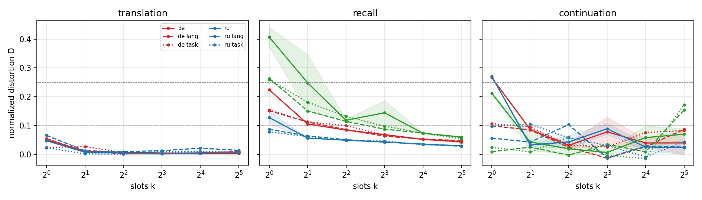
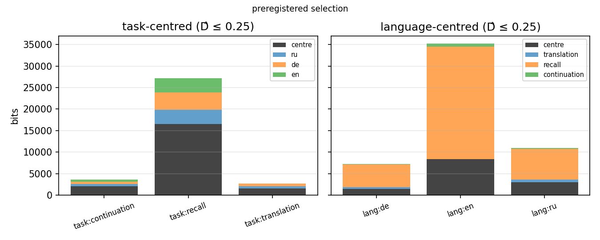
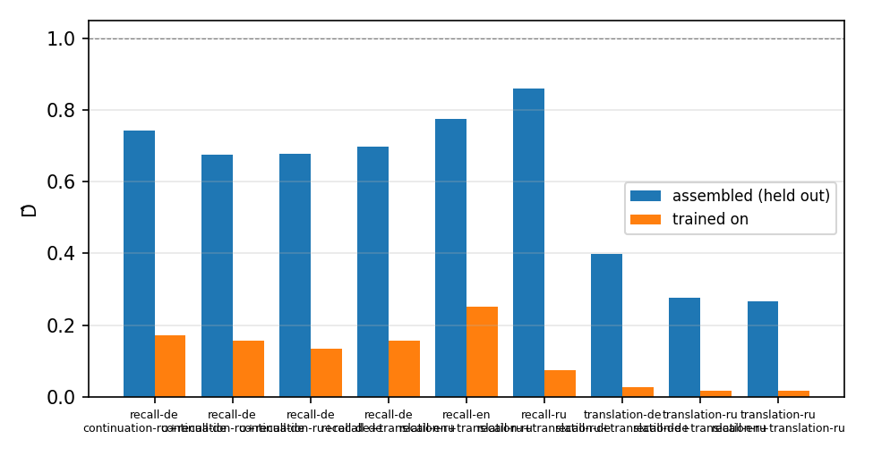
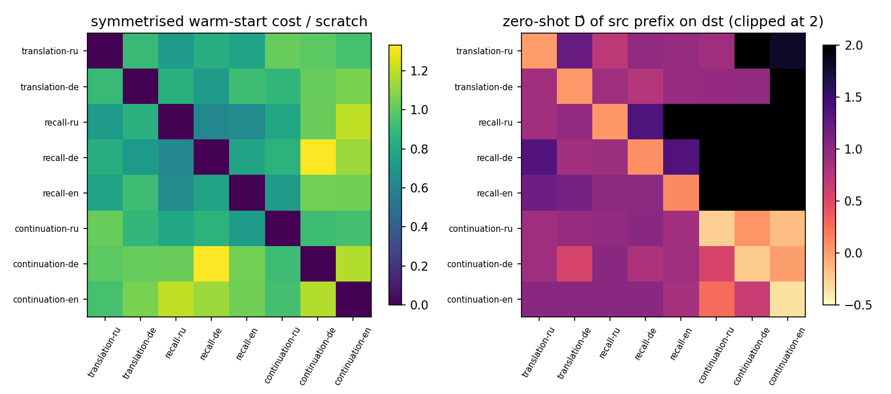
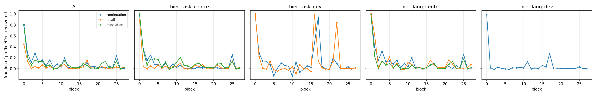
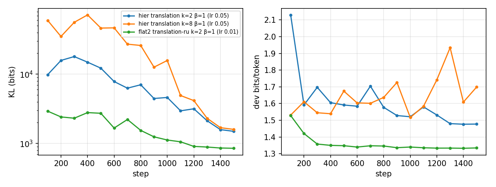

## The idea

- A frozen LM is a fixed machine. A soft prefix that makes it do a task is a **program** for that machine.
- The shortest such program is a model‑relative **description length** of the task (Shaw et al. 2026; Cosma 2026).
- Grid: tasks {translation from English, factual recall, continuation} × output languages {ru, de, en}, Qwen2.5‑1.5B base, frozen.
- Questions: how many bits does a cell cost, how are they split between *task* and *language*, do the parts compose, how far apart are programs, where does the model read them.

## Two units, one distortion

- **Slots**: number $k$ of prefix positions (capacity).
- **Bits**: prefix = diagonal Gaussian posterior; its KL to a prior fitted to the embedding matrix is the code length (bits‑back; Hinton & van Camp 1993).
- Distortion: teacher‑forced bits per target token, normalised per cell
  $$\hat D = \frac{L - L_{\text{floor}}}{L_{\text{none}} - L_{\text{floor}}},\qquad L_{\text{floor}} = \min(\text{LoRA}, \text{best prefix})$$
- Preregistered operating points $\hat D \le 0.25$ and $\le 0.10$.
- 8 cells; ~34 A100 hours; every figure regenerated from CSVs.

## Result 1: slots are not a description length

- Translation: one slot reaches $\hat D \le 0.10$ in every language. Recall needs 2–16 and is still improving at $k = 32$.
- One trained slot beats the natural‑language prompt: recall NL prompt $\hat D$ 0.91–0.96, one slot 0.13–0.41.
- Telling the model the language or the task saves 1.8 slots on average, 8 of them from recall‑en. Continuation: floor ≈ no prefix, unmeasurable.

## Result 2: description length in bits

| cell | bits at $\hat D \le 0.10$ | bits at $\hat D \le 0.25$ |
|---|---|---|
| translation‑de | 436 | 436 |
| translation‑ru | 542 | 542 |
| recall‑ru | 2,419 | 2,419 |
| recall‑de | — (best 0.14) | 3,343 |
| recall‑en | — (best 0.23) | 7,155 |

- A translation program ≈ 500 bits; Russian recall 5×; English recall dearest, also on the 4,212 items shared by all three recall test sets.
- Task ordering follows the learning gap (H1 yes); language ordering does **not** follow exposure (H1 no).

## Result 3: neither nesting is cheaper, and sharing does not compress

{width=78%}

Centre paid once per group, each deviation once per member; cheapest run with every member at $\hat D \le 0.25$.

## Three codes for the same eight cells

| code (all 8 cells, $\hat D \le 0.25$) | protocol | bits |
|---|---|---|
| centre per task + language deviations | prereg. selection | 33,500 |
| eight independent programs | prereg. | 37,600 |
| centre per language + task deviations | prereg. selection | 53,500 |
| centre per task + language deviations | corrected | 26,700 |
| centre per language + task deviations | corrected | not reached (ru + de: 8,900) |
| eight independent programs | corrected | 17,600 |

- Prereg. rule: task‑centred beats language‑centred by 37%. Corrected protocol: the nestings cost the same within 25% at matched (k, β); the language‑centred code never gets recall‑en under 0.25.
- A shared centre **saves no bits**: under the corrected protocol the hierarchy costs 1.5× the independent programs; parity on translation (1,029 vs 978), 1.9× on recall (24,972 vs 12,917).
- At matched (k, β) the hierarchy costs 0.94–1.5× the sum of the flat2 runs; one β for all members then adds the rest.

## What a language costs, what a task costs

- Given the **translation** centre (604 bits): Russian 225, German 200 bits, 0.41–0.46 of a standalone program (corrected protocol; 485 / 662 under the preregistered rule).
- Given the **recall** centre (14,600 bits): a language costs 3,200–3,900 bits, more than a standalone Russian or German program.
- Given a **language** centre (830–900 bits): translation 201 / 257, recall 3,200 / 3,400, continuation 60 (ru / de). Symmetric with the task‑centred costs; the prereg. asymmetry (recall 5,300–26,200 given a language) was the optimiser.
- Recall is the program that cannot be shared: about 3,200 bits as a deviation from either kind of centre.
- For translation alone the hierarchy is at best at parity: 1,029 vs 978 bits (corrected), 2,733 vs 1,893 (prereg.).

## Result 4: composition and distance

::: columns
:::: column

Zero‑shot assembly of task part + language part closes 60–73% of the gap on translation, 14–32% on recall.
::::
:::: column

Same‑task warm start costs 0.85 of scratch, same‑language 0.95. Silhouettes ≈ 0: direction only. Zero‑shot transfer = no prefix; recall prefixes break continuation.
::::
:::

## Result 5: where the program is read

{width=100%}

- Patching the prefix positions into **block 0 alone** recovers 70–94% of the effect for translation and continuation, 36–58% for recall (secondary peak at block 17).
- A translation program is copied into the token stream in the first block; a recall program is read in several places, deep in the network.
- H5: every probe peaks at block 0, but the **language deviation is read again at blocks 16–17** (late mass 1.9 vs early 1.6 on recall) while the task centre is not (0.5 vs 1.0): a split by part, opposite to H5's direction.

## Result 6: the objective is right, the search is hard

{width=62%}

- lr 0.05 = 2 prior σ per step: the centre KL peaks at a median 26k bits (k=2) to 144k (k=8), up to 549k, between steps 100 and 800, then decays.
- Selecting the checkpoint by mean‑posterior distortion picks a high‑rate step (up to 20× the final rate); the mean is not the coded object (translation, β=3: mean $\hat D$ 0.35–0.56, samples 0.06–0.17).
- Corrected protocol (lr 0.01, select on the objective, score samples): frontier **20–71% lower** with 4 runs per cell instead of 9; hierarchy reruns show no overshoot (selected step within 2% of final).
- Shaw et al. (2026): 870 bits from a compiled init vs 2.8M from random init. Here the gap closes by selection and step size.

## Preregistered comparisons

| | outcome |
|---|---|
| H1 cost orderings | task yes (recall far above translation); language no (English dearest) |
| H2 cheap language | slots: equal; bits: equal under the corrected protocol (prereg. 1.3–7.8× asymmetry does not replicate) |
| H3 separability | partial on translation, not on recall; a shared centre saves no bits (1.5× independent); nestings equal within 25% |
| H4 task‑organised distance | direction yes, structure no, not significant (silhouette 0.004 vs −0.09) |
| H5 depth split | language deviation read early and late, task centre early: opposite to H5 |
| H6 input compressibility | one vector suffices with the task prefix (exploratory) |

## Limitations and next steps

- Two seeds; recall budget‑bound (3000 steps: $\hat D$ 0.043 to 0.032 and falling); continuation unmeasurable; distance matrix one seed.
- Variational protocol corrected after preregistration; both reported. Both nestings rerun under it; every corrected rate still falling at 1500 steps.
- Research version, same code: scale axis 0.5B–7B, 20+ languages by resource level, per‑column mixture prior, charge $\log_2|k\text{-grid}|$ bits for $k$, step size in prior‑σ units.
- Repo: `sirotenkogeorgii/prefix-programs`, branch `prefixlab`; `01_figures.ipynb` regenerates everything in under a minute.
